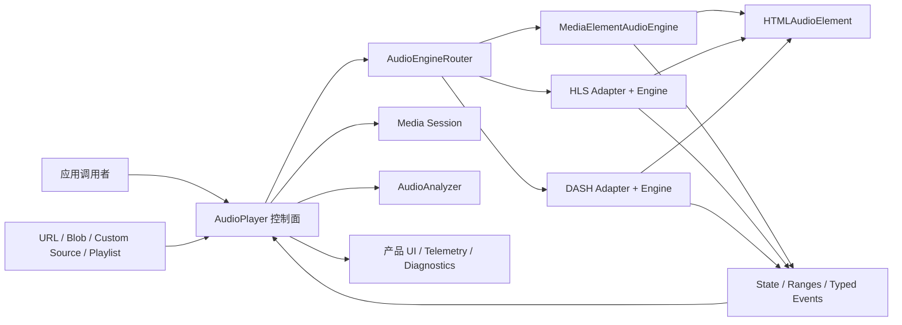
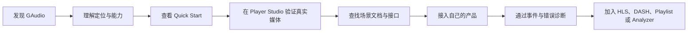
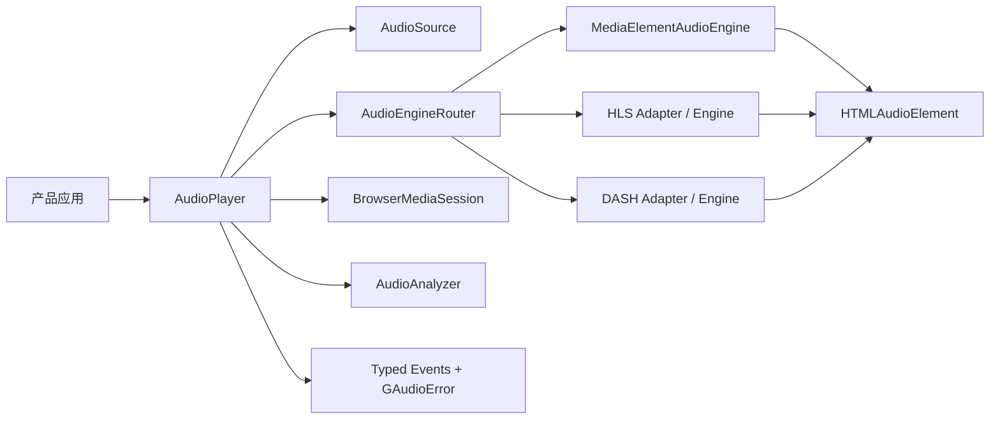

# GAudio 项目分析

> 分析日期：2026-08-21  
> 分析对象：`dev` 分支当前工作区快照  
> 项目版本：`gaudio@0.4.0`，npm 发布通道为 `next`  
> 用途：为后续产品定位、信息架构和原型重绘提供共同事实基础

## 1. 分析口径

本文以 `packages/gaudio` 为核心分析对象。GAudio 不是三个并列产品，而是“一项核心产品 + 两类承载界面”：

1. **核心产品**：面向开发者的浏览器音频播放 TypeScript 库。
2. **理解与采用界面**：解释、教学和承接搜索流量的双语文档站。
3. **体验与验证界面**：用真实音频展示、操作和诊断库能力的 Player Studio。

分析顺序也遵循这个关系：先理解库的 Interface、行为和差异化价值，再判断页面应该展示什么。页面不是分析起点，而是核心库价值的表达层。

结论标签：

- **Executed**：通过命令实际执行、计数或查看得到。
- **Inspected**：通过源代码、配置、测试、文档或设计证据检查确认。
- **Assumed**：缺少真实用户访谈、站点分析或使用数据，属于产品推断。

本文没有使用外部市场调研、竞品数据、npm 下载量、网站分析或真实用户访谈。因此，关于用户优先级、商业价值和原型顺序的判断均明确标记为 **Assumed**。

## 2. 执行摘要

### 2.1 项目本质

GAudio 的核心价值并不是提供一个更漂亮的 `<audio>` 控件，而是把浏览器原生音频、播放列表、Source 生命周期、Media Session、Web Audio 分析以及 HLS/DASH 自适应流，收进一个类型化、可观察、可扩展的播放控制面。**Inspected**

项目当前最有辨识度的定位可以概括为：

> 一个浏览器优先、类型安全、协议可扩展的音频播放基础设施，帮助前端产品用同一套 `AudioPlayer` 接口处理普通媒体、播放列表、分析能力与可选自适应流。

### 2.2 当前成熟度

- 包版本为 `0.4.0`，仍是预发布状态，并明确允许首个正式版本前进行有意的接口调整。**Inspected**
- 核心库已经具备较完整的生命周期、错误、资源清理、扩展和测试体系，不是概念验证。**Inspected**
- 文档站正在从 VitePress 完整迁移到 Nuxt 4；当前工作区存在大量未提交改动。**Executed**
- 首页已经形成较成熟的紫色技术品牌和音频视觉语言；新原型无需从“颜色和风格”完全重新发明，除非这次明确要求品牌重置。**Inspected**
- 文档、Examples 和 Player Studio 的职责仍有重叠，尤其是 `/examples`、`/zh/examples` 和 `/player-studio` 复用同一体验，但命名和语言入口并不完全一致。**Inspected**

### 2.3 对原型重绘最重要的判断

重绘不应先从旧页面或单个漂亮画面开始，而应先把 `packages/gaudio` 的价值组织成可以被用户理解的展示体系：

1. **第一层：一句话价值**——一个 `AudioPlayer` 连接普通媒体、Playlist、HLS、DASH、Media Session 和 Analyzer。
2. **第二层：真实运行过程**——Source 如何打开、路由、加载、播放、产生状态与错误。
3. **第三层：产品级能力**——fallback、备用音轨、系统媒体控制、频谱与自适应质量。
4. **第四层：工程可信度**——严格类型、稳定错误码、SSR-safe 导入、可选依赖和完整验证。

页面结构随后才承担分工：

1. 官网负责“理解与信任”。
2. 文档负责“学习与查询”。
3. Examples 负责“复制场景方案”。
4. Player Studio 负责“操作、验证与诊断”。

如果这四者分工不清，新原型会继续出现入口重复、页面目的混合和主行动不明确的问题。**Assumed，基于当前路由与内容结构**

## `packages/gaudio` 核心库专项分析（主分析）

### 核心判断

`packages/gaudio` 才是整个项目需要被展示的主体。文档站和 Player Studio 的价值，都取决于它们能否让用户理解以下事实：

> GAudio 不是一个播放器皮肤，也不是对 `HTMLAudioElement` 的薄包装；它是一个面向产品音频场景的类型化控制面，在 Source、播放生命周期、浏览器媒体能力和可选 HLS/DASH 运行时之间提供统一协调。

这个判断来自公共 Interface、内部实现和 550 项当前通过的核心测试，而不是来自现有首页文案。**Inspected + Executed**

### 包级交付契约

GAudio 发布为一个具有三个入口的 npm 包：

| 入口 | 面向用户的职责 | 依赖策略 | 本次构建入口文件 |
| --- | --- | --- | ---: |
| `gaudio` | Player、Source、Analyzer、事件、错误、Engine Interface 与共享自适应类型 | 不加载 HLS/DASH 供应商 | ESM 100.85 kB / gzip 18.71 kB |
| `gaudio/hls` | HLS Adapter factory、策略与 `hls.js` 配置类型 | `hls.js` 为可选 peer，使用时动态导入 | ESM 26.61 kB / gzip 5.95 kB |
| `gaudio/dash` | DASH Adapter factory 与 `dashjs` settings 类型 | `dashjs` 为可选 peer，使用时动态导入 | ESM 24.18 kB / gzip 6.01 kB |

以上数字来自本次 `pnpm --filter gaudio build` 的入口文件输出，未计共享 chunk，也不是应用经 tree shaking 后的最终体积。**Executed**

包同时提供：

- ESM 与 CommonJS。
- `.d.ts` 与 `.d.cts`。
- JavaScript source map。
- Declaration source map，并嵌入发布后仍可用的源内容。
- Node 18 的包导入兼容底线。
- TypeScript 5.8.3 的声明消费底线验证。
- `sideEffects: false`，为消费端 tree shaking 提供包元数据保证。

这说明 GAudio 对外展示时不应只谈播放效果，还应展示它是一项可以被真实工程采用的包产品。**Inspected**

### 实现复杂度分布

| Module 区域 | 非测试文件 | 代码行 | 复杂度含义 |
| --- | ---: | ---: | --- |
| Player | 5 | 2,988 | 高层控制、Playlist、Media Session 与状态协调 |
| Engine | 8 | 3,157 | 浏览器播放实现、路由、并发门控与清理 |
| Adapter | 18 | 2,629 | HLS/DASH、预设、内容类型和供应商桥接 |
| Source | 4 | 218 | URL、Blob、自定义资源生命周期 |
| Analyzer | 1 | 114 | Web Audio 频域和时域采样 |
| Events | 1 | 136 | 强类型事件与监听器隔离 |
| Errors | 1 | 39 | 稳定错误码与 cause |

以上为当前源文件实际计数。**Executed**

复杂度主要集中在 Player、Engine 和 Adapter，说明核心价值确实位于“协调播放生命周期与不同运行时”，而不是 UI 或格式列表。

### 六层能力模型

从库的 Interface 出发，GAudio 可以被理解为六层能力，而不是一张扁平功能清单：

#### 1. 输入层：Source

接收：

- 普通 URL 字符串。
- 带 `protocol` / `mimeType` 的 Source description。
- 本地 `Blob` / `File`。
- 自定义懒加载 Source。
- Playlist Track、fallback source 和备用音轨。

输入层解决“音频资源从哪里来、谁拥有它、什么时候释放”的问题。

#### 2. 控制层：AudioPlayer

提供：

- load、play、pause、stop。
- seek 与 fast seek。
- preload、autoplay、loop、volume、mute、rate、pitch preservation。
- Source 更换、Playlist 导航和备用音轨选择。
- Analyzer、Media Session 和自适应质量入口。

控制层解决“应用用什么统一 Interface 操作音频”的问题。

#### 3. 路由层：AudioEngineRouter

根据显式协议、MIME、URL 扩展名和默认媒体路径选择 Engine，并把当前设置迁移到新的运行时。

路由层解决“同一个 Player 如何处理普通媒体、HLS 与 DASH”的问题。

#### 4. 运行层：AudioEngine 与 Adapter

实际运行时包括：

- `MediaElementAudioEngine`。
- 原生 HLS。
- `hls.js`。
- `dash.js`。
- 调用者注入的自定义 Engine。

运行层解决“具体由哪种浏览器或供应商能力完成播放”的问题。

#### 5. 产品能力层

包括：

- Playlist 与自动续播。
- fallback source。
- 多语言或伴随音轨。
- Media Session。
- Analyzer。
- HLS/DASH 预设、内容类型与质量控制。

这一层使 GAudio 超出基础媒体控件，进入播客、有声书、音乐、直播和多语言产品场景。

#### 6. 可观察层

包括：

- Playback State。
- 媒体生命周期事件。
- buffered / seekable / played ranges。
- Manifest、Variant 和 Segment 事件。
- recoverable / fatal adaptive error。
- 稳定 `GAudioErrorCode`。

可观察层解决“应用如何知道正在发生什么，并把它呈现给用户或遥测系统”的问题。

### 从调用者到浏览器的完整运行链



这条运行链应该成为官网架构展示和 Player Studio 诊断视图的共同结构。现有首页已经表达了一部分，但新原型需要把 Source、状态、错误和产品 UI 的回路补完整。**Assumed，基于实现结构**

### `AudioPlayer`：核心控制面

`AudioPlayer` 是用户最先学习、也最重要的 Module。它公开的能力较多，但其深度来自隐藏以下实现复杂度：

- Engine 选择与替换。
- Source 打开、关闭和失败重试。
- 并发 load / play / seek / quality operation 的失效。
- 新 Source 对旧操作的取消。
- fatal Engine error 与 Promise 结果的统一。
- 错误事件去重。
- autoplay 与显式 play 的意图区分。
- pause / stop 对迟到 play 结果的约束。
- Playlist fallback 与自动下一首。
- 备用音轨切换时保留播放时间和状态。
- Analyzer 与 Engine 的释放顺序。
- Media Session 所有权、元数据和系统动作。
- dispose 后安全查询与重试未完成清理。

#### 生命周期状态

公开状态为：

```text
idle → loading → ready → playing
                    ↘ paused
playing ↔ buffering
playing → ended
任意关键阶段 → error
dispose 为终态，但只读查询保持安全快照
```

实际语义比这张简图更严格：

- `play()` 在未加载时会先完成 load。
- `stop()` 保留已加载 Source，将位置归零并回到 ready。
- 新 Source 或新 load 会让旧 load 以 `LOAD_ABORTED` 结束。
- 新 seek、stop 或 Source 更换会终止旧位置操作。
- dispose 会立即终止进行中的异步操作，并继续尝试资源清理。
- fatal Engine error 会使用同一个 `GAudioError` 实例拒绝当前操作并通知监听器。

这些行为是 GAudio 与简单播放器 wrapper 的关键差异。原型应通过状态时间线、操作取消和错误诊断展示，而不是只放一个 Play 按钮。**Inspected**

### Source：资源所有权模型

Source Interface 不只是一个 URL 字段，而是资源生命周期契约：

```ts
interface AudioSource {
  kind: 'url' | 'blob'
  url?: string
  protocol?: 'media' | 'hls' | 'dash'
  mimeType?: string
  open(): Promise<{ url: string }>
  close(): Promise<void>
}
```

关键规则：

- `close()` 可能在 `open()` 尚未完成时被调用。
- `close()` 可能重复调用。
- 失败的清理必须保留状态，让后续 load/unload/dispose 重试。
- 迟到的 `open()` 结果不能重新激活已取消资源。

这让 GAudio 可以处理：

- 临时签名 URL。
- 需要释放的媒体租约。
- 本地文件 object URL。
- 应用拥有的鉴权和资源创建流程。

展示策略：用“普通 URL → 本地 File → 签名 Source”三档示例表达 Source 的深度，比只列 MP3/WAV 格式更能说明核心价值。

### Playlist：面向产品而不是文件列表

Playlist Interface 内建：

- 主 Source。
- 有序 fallback sources。
- Track metadata。
- Media Session artwork。
- 备用音轨目录。
- 默认音轨。
- 切换音轨时保留时间与播放意图。
- 非 loop 场景自动续播。

因此它适合表达的真实产品场景包括：

| 场景 | GAudio 能力 |
| --- | --- |
| 播客队列 | Playlist、自动续播、Media Session |
| 有声书 | long-form、自定义进度、系统控制 |
| 多语言视频伴随音频 | alternate audio tracks、保留时间点 |
| 多 CDN 容灾 | fallback sources |
| 本地预览 | BlobAudioSource |

展示策略：Playlist 不应只画成左侧曲目列表，应同时让用户看到 fallback、metadata、系统媒体控制和音轨连续性。

### Engine 与 Router：真正的协议统一

`AudioEngine` 是核心 Seam。它的 Interface 定义播放运行时必须支持的生命周期、控制、查询和事件；`MediaElementAudioEngine`、HLS Engine、DASH Engine 与自定义 Engine 坐在同一个 Seam 上。

Router 的协议选择顺序是：

1. Source 显式 `protocol`。
2. MIME 类型。
3. URL pathname 扩展名。
4. 默认 `media`。

Router 还负责：

- 一个协议只能注册一个 Adapter。
- 同一个 Adapter 实例不能同时被多个 Router/Player 占用。
- Engine 切换时同步 preload、autoplay、volume、mute、loop、rate 和 pitch。
- 旧 Engine 的事件不能污染新 Source。
- Engine factory 延迟返回时仍遵守新的所有权。
- 失败清理在之后的 load/dispose 中重试。
- 自适应能力和普通媒体能力使用同一查询入口。

展示策略：官网中的架构图应突出 Router 的“选择 + 所有权 + 状态迁移”，而不是把它画成普通箭头分流器。

### HLS 与 DASH：协议无关层和供应商逃生口

GAudio 没有试图完全抹平供应商差异，而是提供两层 Interface：

#### 协议无关层

- `AdaptivePlaybackPreset`：FastStart / Balanced / Stable。
- `AdaptiveContentType`：vod / long-form / live。
- Active protocol 与 implementation。
- Manifest 与 Variant。
- 自动或手动质量选择。
- Segment 事件。
- 统一的 adaptive error category。

#### 供应商层

- HLS：`hlsInstance`、`getConfig()`、`updateConfig()`。
- DASH：`dashInstance`、`getSettings()`、`updateSettings()`。
- 高级用户仍可使用供应商 request hook 和完整配置。

这是一项重要产品取舍：新用户先使用协议无关的预设，高级用户再进入供应商配置，而不是把所有 `hls.js` / `dashjs` 参数暴露到第一层。

#### HLS 特性

- native-first、hls-first、native-only、hls-only。
- 浏览器原生 HLS 和 `hls.js` 之间确定性选择。
- `hls.js` 只在真正选中时动态导入。
- 配置默认应用于后续 load，也可显式 reload 当前 Engine。
- reload 可选择恢复时间与播放状态，但会失去缓冲、估算和重试状态。

#### DASH 特性

- 通过 MSE codec 能力检测。
- `dashjs` 只在创建 DASH Engine 时动态导入。
- 支持递归稀疏 settings 更新。
- 将供应商 representation id 转为碰撞安全的公共 Variant id。
- 手动质量选择在供应商确认渲染后再发布完成事件。

展示策略：不要只放“HLS + DASH”两个 Logo。应让用户看到“同一个 Source 面板、同一套状态和质量视图，在底层切换实现”。

### 自适应播放预设的产品价值

三个预设把供应商级参数压缩为用户可以理解的决策：

| 预设 | 用户意图 | 可视化表达建议 |
| --- | --- | --- |
| FastStart | 更快开始、频繁切换、预览 | 短 buffer、快速启动 |
| Balanced | 常规音乐、播客、有声书 | 启动与稳定平衡 |
| Stable | 弱网、长音频、稳定优先 | 长 buffer、更多重试 |

再与三类内容形态组合：

| 内容类型 | 典型场景 |
| --- | --- |
| vod | 单曲、专辑、普通播客 |
| long-form | 有声书、长播客、档案节目 |
| live | 直播电台、滚动直播、DVR |

这形成一个非常适合原型展示的二维模型：用户先选“内容是什么”，再选“体验偏好是什么”，系统生成 HLS/DASH 的具体运行设置。

### 可观察性：最值得强化的差异化

#### Playback State

- idle
- loading
- ready
- playing
- paused
- buffering
- ended
- error

#### 核心事件

- loadstart、loadedmetadata、canplay。
- play、playing、pause、waiting、ended。
- seeking、seeked、timeupdate。
- durationchange、bufferupdate。
- volumechange、ratechange。

#### 自适应事件

- adaptivechange。
- manifestloaded。
- variantchange。
- segmentloadstart / segmentloaded。
- streamerror。

#### 稳定错误码

- SOURCE_UNAVAILABLE。
- ADAPTER_UNAVAILABLE。
- PROTOCOL_UNSUPPORTED。
- MANIFEST_ERROR。
- SEGMENT_ERROR。
- ADAPTIVE_STREAM_ERROR。
- LOAD_ABORTED。
- DECODE_FAILED。
- PLAYBACK_BLOCKED。
- UNSUPPORTED_FORMAT。
- NETWORK_ERROR。
- ENGINE_ERROR。

这套可观察性可以直接驱动：

- 产品状态 UI。
- 事件时间线。
- 网络与质量诊断。
- 错误恢复建议。
- 埋点与日志。
- 自动化测试。

展示策略：Player Studio 的核心不是播放器皮肤，而应该是“播放控制 + 实时运行状态 + 事件时间线 + 错误解释”。

### Media Session：跨出网页边界

Media Session 将 GAudio 的行为扩展到：

- 浏览器媒体面板。
- 操作系统媒体控件。
- 耳机按键。
- 键盘媒体键。
- 支持环境中的锁屏元数据。

实现还处理多个 Player 对同一浏览器 Media Session 的所有权：新的 Player 成为当前 owner，销毁后可恢复前一个 owner。系统动作的同步/异步失败会被隔离，不会破坏 Player 监听器链。**Inspected**

展示策略：使用一个小型“网页播放器 → 系统媒体面板”的关系图，比单独列出 Media Session 名称更容易理解。

### Analyzer：从控制能力进入体验能力

Analyzer 提供：

- byte frequency magnitudes。
- byte waveform samples。
- 可选 FFT size。
- Player-owned 或自定义 factory。
- 与普通媒体、HLS、DASH Engine 结合。

它为频谱、波形、可视化、响度提示和自定义 Web Audio 图提供数据，而不强迫 GAudio 自带某一种视觉样式。

需要明确的限制：跨域音频可能可以播放，但如果响应没有允许 Web Audio 的 CORS，Analyzer 可能保持静默。**Inspected**

展示策略：实时视觉应该明确标记“由真实 Analyzer 数据驱动”，避免用户把它误解为纯装饰动画。

### 扩展模型

| Seam | 调用者可以替换什么 | 典型用途 |
| --- | --- | --- |
| `AudioSource` | 资源打开与关闭 | 签名 URL、租约、本地文件、自有资源 |
| `AudioEngine` | 完整播放运行时 | 特殊媒体环境或自定义播放后端 |
| `AudioEngineAdapter` | 协议到 Engine 的创建 | 未来流媒体协议或供应商运行时 |
| Analyzer factory | 分析图创建 | 应用自有 Web Audio graph |
| Typed events | 观察与组合 | UI、遥测、日志、业务联动 |
| `MediaElementAudioEngine` 继承 | 浏览器媒体元素行为 | 需要受控 subclass hook 的高级实现 |

`AudioPlayer`、`AudioAnalyzer` 和 `EventEmitter` 不承诺 subclass 兼容，推荐直接使用或组合。只有 `MediaElementAudioEngine` 提供受支持的继承契约。**Inspected**

从深模块角度：

- `AudioEngine` 有多个真实 Adapter，是有效 Seam。
- `AudioSource` 把资源所有权集中在实现中，带来 Locality。
- `AudioEngineRouter` 把协议选择和 Engine 更换集中在一个 Module 中，带来 Leverage。
- `AudioPlayer` 具有较高 Depth，但 Interface 已较宽，应避免继续把供应商细节加入主控制面。

### 工程可信度

核心包的可信度不只来自单元测试数量，还来自交付链：

- strict TypeScript。
- ESM + CommonJS。
- 三个独立导入入口。
- optional peer dependency。
- `publint`。
- Are The Types Wrong 检查。
- 声明 source map 完整性验证。
- 真实 npm tarball 消费验证。
- Node 18 无可选 peer 导入验证。
- TypeScript 5.8.3 与当前版本验证。
- Node16、NodeNext、Bundler module resolution 验证。
- Chromium、Firefox、WebKit 和移动模拟 E2E。

本次实际执行结果：Type Check、Lint、550 项核心测试、Build、publint、Are The Types Wrong、Declaration source map 验证和 pack dry run 全部通过。**Executed**

### 核心测试揭示的真实设计重点

测试标题和断言显示，项目最重视的不是简单 happy path，而是：

- pending load/play/seek 永不 settle 时仍能被替代或销毁。
- re-entrant 监听器在状态变化时触发新的操作。
- 旧 Engine 的迟到事件不能污染新 Source。
- fatal error 只发布一次并保持对象身份。
- fallback 成功时不误报旧错误。
- Analyzer、Source、Engine 清理失败后可以重试。
- Media Session 多 owner 的恢复。
- 自适应 Variant id、手动选择与错误分类。
- 自定义 Engine/Source/Analyzer 的原始错误语义。
- dispose 后所有只读查询保持安全。

这说明 GAudio 的核心品牌词应该包括“deterministic lifecycle / observable playback / explicit ownership”，而不只是“TypeScript / HLS / DASH”。**Assumed，基于测试重点提炼**

### GAudio 不是什么

为避免原型错误表达，需要明确：

- 不是音乐内容平台。
- 不是音频托管或转码服务。
- 不是 DRM 系统。
- 不是跨平台原生播放器 SDK。
- 不是完整 UI 组件库。
- 不是对所有供应商差异的绝对抽象。
- 不是 gapless playback Engine。
- `HttpAudioSource` 不是请求鉴权层。
- Analyzer 不是音频编辑或 DSP 套件。

### 核心库应该如何被展示

#### 第一层：10 秒理解

主张：

> 一个类型化 `AudioPlayer`，连接浏览器里的每一种产品音频路径。

立即展示：普通文件、Playlist、HLS、DASH 四类 Source 进入一个控制面，再路由到不同 Engine。

#### 第二层：30 秒建立价值

展示四组价值：

1. 统一控制：load、play、seek、settings。
2. 产品播放流：Playlist、fallback、备用音轨、Media Session。
3. 可观察性：state、ranges、events、errors、quality。
4. 可扩展性：Source、Engine、Adapter、Analyzer。

#### 第三层：2 分钟建立信任

展示真实运行：

- 选择 MP3/HLS/DASH。
- 同一个控制面开始播放。
- Runtime Inspector 更新协议、实现、质量、buffer。
- Event Timeline 出现 lifecycle 与 segment 事件。
- 切换 Source 时旧操作被正确终止。
- 错误时显示稳定 code、cause 和恢复建议。

#### 第四层：工程采用

展示：

- 三个导入入口。
- 可选 peer。
- SSR-safe import。
- 兼容性矩阵。
- 包验证结果。
- Quick Start 与场景代码。

### 推荐的官网展示顺序

1. **核心主张**：一个 AudioPlayer，统一产品音频。
2. **真实控制面**：可播放的简洁 Demo，不先展示所有高级控件。
3. **信号路径**：Source → AudioPlayer → Router → Engine → Events/UI。
4. **产品场景**：普通文件、Podcast Queue、Long-form、Live、Multi-language。
5. **可观察性**：状态、buffer、quality、event、error。
6. **扩展 Seam**：Source、Engine、Adapter、Analyzer。
7. **工程可信度**：类型、入口、可选依赖、浏览器与测试。
8. **Quick Start**：最短可运行代码与进入文档/Studio。

### 推荐的 Player Studio 信息结构

Player Studio 应成为库的“活体说明书”，而不是现有页面的视觉放大版：

| 区域 | 展示的核心库能力 |
| --- | --- |
| Source Lab | URL、File、Playlist、协议提示、样例 |
| Control Deck | load、play、pause、stop、seek、volume、rate |
| Runtime Inspector | protocol、implementation、preset、content type、variant |
| Timeline | current、duration、buffered、seekable、played |
| Event Stream | lifecycle、Manifest、Variant、Segment、error |
| Product Features | fallback、alternate audio、Media Session、Analyzer |
| Code Panel | 当前操作对应的最小 TypeScript 代码 |

### 原型中应避免的表达

- 用格式 Logo 墙代替运行模型。
- 把 GAudio 画成面向听众的音乐 App。
- 只展示播放成功，不展示 loading、buffering、error 和 superseded operation。
- 把所有 `hls.js` / `dashjs` 配置平铺到默认界面。
- 把实时 Analyzer 视觉当作没有数据来源的装饰。
- 只展示 HLS/DASH，弱化普通媒体、Playlist 和 Source 生命周期。
- 先展示内部类名，再解释用户价值。
- 让首页、Examples 和 Player Studio 重复同一个全功能播放器。

## 3. 项目快照

### 3.1 仓库结构

项目采用 pnpm workspace 与 Turborepo，当前主要包含两个工作区：

```text
gaudio/
├── packages/
│   └── gaudio/        # 可发布 TypeScript 音频库
├── apps/
│   └── docs/          # Nuxt 4 文档站与 Player Studio
├── project/           # 历史方案、规格与路线记录
├── design-reference/  # 当前视觉实现与对照证据
├── .github/workflows/ # CI、文档部署和包发布
└── project-analysis.md
```

### 3.2 规模概览

| 项目 | 当前规模 | 说明 |
| --- | ---: | --- |
| 核心库非测试 TypeScript | 41 个文件，约 9,650 行 | 包含 Player、Engine、Source、Analyzer、Adapter 等 |
| 核心库测试 | 16 个文件，约 12,447 行 | 测试代码量高于实现代码量 |
| 核心库测试声明 | 约 572 个 `describe` / `it` / `test` 调用 | 静态计数，不等同于本次实际通过数量 |
| 文档应用、示例与文档辅助代码 | 61 个 TS/Vue 文件，约 6,374 行 | 不含 CSS、生成 API Markdown 和媒体文件 |
| 文档侧测试声明 | 约 86 个 `describe` / `it` / `test` 调用 | 包含单元与 E2E 测试源文件 |
| 当前可见 Markdown | 14 个文件 | TypeDoc API 文档会在构建时继续生成 |
| 演示音频 | 约 9.5 MB | MP3、M4A、WAV、OGG、HLS、DASH |
| 设计参考 | 约 16 MB | 桌面、移动、明暗主题与对照图 |

以上计数为 **Executed**。

### 3.3 当前工作区状态

当前位于 `dev` 分支，工作区包含一轮尚未提交的 VitePress → Nuxt 迁移：

- 删除旧 `.vitepress` 应用与旧首页/示例入口。
- 新增 Nuxt `app/`、`content.config.ts`、`nuxt.config.ts` 和 Vercel 配置。
- 更新 CI、测试、链接检查、许可证、演示和锁文件。
- 当前已跟踪差异约为 40,540 行新增、10,564 行删除，另有未跟踪的新 Nuxt 文件和设计资料。**Executed**

因此本文描述的是“当前工作区快照”，不是某个已经发布的稳定提交。

## 4. 产品定位分析

### 4.1 核心问题

浏览器音频产品通常面临的复杂度包括：

- 普通音频、HLS 和 DASH 使用不同运行时。
- 播放状态、缓冲、seek、错误和并发操作难以保持一致。
- 播放列表、备用源、备用音轨和 Media Session 需要产品层协调。
- 可视化和音频分析涉及 Web Audio 生命周期与资源清理。
- 自适应流供应商暴露不同的事件、质量和配置方式。
- SSR 环境可以导入库，但不能在服务端执行浏览器播放能力。

GAudio 的策略是让应用主要面向 `AudioPlayer`，再通过明确的扩展缝隙接入不同 Source、Engine、Adapter 和 Analyzer。**Inspected**

### 4.2 产品承诺

从 README、公共接口和文档可以提炼出六项产品承诺：

1. **一个播放器接口**：普通媒体、HLS、DASH 和播放列表共享同一控制面。
2. **类型化生命周期**：状态、事件、错误码、范围和自适应流信息都有严格类型。
3. **产品级播放能力**：不止播放/暂停，还覆盖队列、备用源、备用音轨、Media Session 和 Analyzer。
4. **按需引入复杂度**：根入口不加载 `hls.js` 或 `dashjs`，自适应协议通过独立子路径和可选 peer dependency 使用。
5. **可观察与可诊断**：暴露状态、范围、Manifest、Segment、Variant、协议和稳定错误码。
6. **扩展但不鼓励继承**：主要通过组合、接口和 Adapter 扩展；只有 `MediaElementAudioEngine` 提供受支持的继承契约。

### 4.3 差异化优势

| 差异点 | 对用户的价值 |
| --- | --- |
| `AudioPlayer` 统一普通媒体与自适应流 | 应用不用为每种协议维护完全不同的控制层 |
| HLS/DASH 可选且懒加载 | 核心包不被大型供应商运行时拖重 |
| Source 有 `open()` / `close()` 生命周期 | 可处理签名 URL、本地 Blob 和应用自有资源 |
| Playlist 支持 fallback 与备用音轨 | 更接近播客、有声书和多语言产品需求 |
| Media Session 集成 | 可连接系统媒体键、耳机和锁屏元数据 |
| Analyzer 集成 | 支持可视化、频谱和波形产品体验 |
| 稳定错误码与丰富事件 | 便于 UI 反馈、日志、遥测和故障诊断 |
| HLS/DASH 预设与内容类型 | 将复杂供应商配置压缩为更可理解的产品选项 |

### 4.4 当前限制

- 仍处于预发布阶段，公共接口可能调整。**Inspected**
- 协议切换不是无缝播放；会卸载当前 Engine 并创建下一个。**Inspected**
- 原生 HLS 不暴露与 `hls.js` 等价的手动码率和供应商级诊断能力。**Inspected**
- `HttpAudioSource` 只是 URL 包装器，不负责请求头、Cookie、凭证或签名刷新。**Inspected**
- HLS/DASH 的鉴权通常仍需供应商请求 hook。**Inspected**
- 浏览器支持以能力检测为准，而不是一组固定最低版本。**Inspected**
- DASH 的供应商工具链与 Node 兼容要求高于核心包的 Node 18 导入兼容底线。**Inspected**

## 5. 用户分析

真实用户优先级尚未通过访谈或数据验证，以下属于 **Assumed**。

### 5.1 主要用户

#### A. 正在集成音频能力的前端开发者

- 熟悉 TypeScript、Vue/React 或浏览器应用。
- 不一定熟悉 HLS、DASH、MSE、Media Session 或 Web Audio。
- 希望尽快完成第一段可播放代码。
- 需要理解浏览器差异、错误和资源生命周期。

最重要任务：

> 在较少学习成本下，把一种或多种音频来源可靠地接入产品，并获得可渲染的状态与错误信息。

#### B. 构建音频产品基础设施的高级开发者

- 负责播客、有声书、音乐、直播或多语言音轨。
- 关心 fallback、ABR、缓冲、诊断、签名 URL 和扩展点。
- 需要确认库不会隐藏必须的底层能力。

最重要任务：

> 验证 GAudio 能否覆盖生产级边缘情况，并确认扩展缝隙、错误语义和供应商逃生口足够可靠。

#### C. 正在评估依赖的技术负责人

- 关注包体积、维护性、浏览器兼容、测试、许可证和发布流程。
- 不一定亲自完成全部集成。

最重要任务：

> 快速判断 GAudio 是否值得进入项目依赖树，以及采用它会引入哪些运行时和维护风险。

### 5.2 次要用户

- 产品经理或设计师：需要体验播放器能力和状态，但不阅读完整接口文档。
- 库维护者：需要发布、兼容性验证、文档同步与回归检查。
- 内容或 QA 团队：需要验证不同格式、协议和浏览器的播放结果。

### 5.3 用户从认知到采用的完整路径



当前站点已经覆盖这条路径的大部分节点，但不同节点之间的产品分工还可以更明确。**Inspected + Assumed**

## 6. 功能能力地图

### 6.1 核心播放

- `load()`、`play()`、`pause()`、`stop()`。
- 精确 seek 与 `fastSeek()`。
- preload、autoplay、loop、volume、mute、playback rate、pitch preservation。
- current time、duration、buffered、seekable、played ranges。
- `idle`、`loading`、`ready`、`playing`、`paused`、`buffering`、`ended`、`error` 状态。

### 6.2 Source 生命周期

- 字符串 URL。
- 显式 `AudioSourceDescription`。
- `HttpAudioSource`。
- `BlobAudioSource`，负责 object URL 清理。
- 自定义懒加载 `AudioSource`，支持 `open()` / `close()`。
- MIME、显式协议和 URL 扩展名共同参与协议识别。

### 6.3 Playlist 与产品播放流

- 有序播放与自动下一首。
- previous / next / 指定索引选择。
- 每个 Track 的 fallback sources。
- 元数据、封面、Media Session。
- 多语言或伴随音轨。
- 切换音轨时保留时间点与播放状态。

### 6.4 浏览器与系统集成

- Media Session 元数据。
- 播放、暂停、停止、上一首、下一首、seek 等系统动作。
- 键盘、耳机、系统媒体面板和支持浏览器的锁屏信息。

### 6.5 音频分析

- Player 持有的 Analyzer。
- 频域采样。
- 波形采样。
- 自定义 Analyzer factory。
- 支持产品自定义 Canvas/WebGL 可视化。

### 6.6 自适应流

- HLS：原生或 `hls.js`，支持四种选择策略。
- DASH：`dashjs`。
- `FastStart`、`Balanced`、`Stable` 三类播放预设。
- `vod`、`long-form`、`live` 三类内容形态。
- Manifest、Segment、Variant、recoverable stream error 等事件。
- 自动 ABR 与支持情况下的手动质量选择。
- HLS 配置更新与显式 reload。
- DASH 运行时 settings 更新。

### 6.7 可观察性与错误

稳定错误码覆盖：

- Source 缺失或失效。
- 加载中止和播放失败。
- Engine 错误。
- Adapter 不可用。
- 协议不支持。
- Analyzer 不可用。
- Player 已销毁。

事件接口覆盖媒体生命周期、时间、缓冲、音量、速率、自适应状态、Manifest、Variant、Segment 和错误。

## 7. 产品界面与信息架构

### 7.1 当前主要页面

| 页面/路由 | 当前角色 | 用户主要任务 | 观察 |
| --- | --- | --- | --- |
| `/`、`/zh` | 产品首页 | 理解价值、建立信任、进入 Studio 或文档 | 视觉叙事成熟，强调 AudioPlayer、架构、能力与 Quick Start |
| `/docs`、`/zh/docs` | 文档入口 | 按任务或主题选择学习路径 | 同时提供搜索、版本和学习路径 |
| `/guide/*`、`/zh/guide/*` | 指南 | 学习配置、场景、自适应播放和事件 | 中英文分别维护 |
| `/api/*`、`/zh/api/*` | 接口参考 | 查询类、类型、方法与错误 | 英文由 TypeDoc 生成；中文路径复用英文内容并标记语言 |
| `/examples`、`/zh/examples` | 交互示例 | 操作真实播放器、查看能力 | 实际渲染完整 `ExamplesPage` 与 `AudioPlayerDemo` |
| `/player-studio` | Player Studio | 验证真实播放链路 | 同样渲染 `ExamplesPage`，与 Examples 职责重叠 |
| 404 | 错误恢复 | 返回对应语言首页 | 使用“信号丢失”的品牌化表达 |

### 7.2 当前导航

桌面主导航包含：Guide、Examples、API、Player Studio。页头同时提供搜索、GitHub、主题和语言切换；移动端展开更完整的 Guide 快捷入口。**Inspected**

文档页另有：

- 左侧分组导航。
- 当前页目录。
- 上一页/下一页。
- 搜索对话框。
- 标题锚点与代码高亮。

### 7.3 信息架构问题

#### Examples 与 Player Studio 的边界不清

三个路由最终使用同一个页面模块：

- `/examples`
- `/zh/examples`
- `/player-studio`

这会带来两个问题：

1. 用户难以理解“Examples”和“Player Studio”是否是两个产品。
2. 导航同时展示两个名称，却没有明显不同的任务或内容。**Inspected + Assumed**

建议二选一：

- 将 Player Studio 定义为唯一交互产品，Examples 变为场景代码集合；或者
- 将 Examples 作为总入口，Player Studio 成为其中一个明确的交互示例。

#### Player Studio 的中文入口不一致

`/zh/examples` 可以显示中文 demo 文案，但中文页头和中文文档概览中的 Player Studio 链接固定指向 `/player-studio`；语言判断只基于 `/zh` 前缀，因此会进入英文上下文。语言切换又会从 `/player-studio` 跳到 `/zh/examples`。**Inspected**

这不是视觉问题，而是路由模型和产品命名问题，适合在新原型阶段先决定。

#### 首页、Docs 首页与 Guide 首页存在多层“开始使用”入口

这些入口都合理，但需要更清楚的层级：

- 首页：为什么选择 GAudio。
- Docs 首页：应该从哪类任务开始。
- Getting Started：如何完成第一段代码。

新原型应让三个页面各自只承担一个核心决策。**Assumed**

## 8. 技术架构

### 8.1 总体结构



### 8.2 `AudioPlayer`：主要深模块

`AudioPlayer` 是应用调用者面对的主要 Module。它的 Interface 较宽，覆盖状态查询、配置、播放、Playlist、备用音轨、自适应质量、Media Session、Analyzer 和销毁；实现则隐藏了更复杂的并发与生命周期协调。**Inspected**

它内部集中处理：

- load/play/seek 等并发操作的失效与取消。
- 被新请求替代时的 `LOAD_ABORTED` 语义。
- Engine fatal error 与 Promise 失败的关联。
- 错误事件去重。
- Source、Analyzer 与 Engine 的释放顺序。
- autoplay 意图和播放状态恢复。
- Playlist fallback 和自动续播。
- 音轨切换时的时间点与播放意图保持。
- Media Session 与状态、元数据、进度同步。

从代码库设计角度看，它具有较高 **Depth**：调用者学习一个 Interface，获得大量跨协议行为；复杂度被集中在一个实现中，产生 **Leverage** 和 **Locality**。但 Interface 已经包含大量查询和控制方法，认知成本并不低。**Inspected**

原型含义：Player Studio 不应把所有方法平铺为同等重要的控件，而应按用户任务分层。

### 8.3 `AudioEngine`：核心 Seam

`AudioEngine` 定义播放运行时必须满足的 Interface，包含：

- 生命周期与播放控制。
- 播放参数和状态查询。
- 时间范围。
- 可选自适应流查询与质量控制。
- 可选 Analyzer 创建。
- 类型化事件订阅。

`MediaElementAudioEngine`、`HlsAudioEngine` 和 `DashAudioEngine` 是这个 Seam 上的不同 Adapter/实现。由于至少存在多个真实实现，这个 Seam 不是假设性的抽象。**Inspected**

### 8.4 `AudioEngineRouter`：协议路由 Module

Router 根据以下顺序选择运行时：

1. Source 显式协议。
2. MIME 类型。
3. URL 扩展名。
4. 默认普通媒体。

它将协议检测、Adapter 选择、Engine 切换和事件转发集中在一个位置，避免调用者在每个页面或业务模块重复判断 HLS/DASH。这个 Module 对调用者具有明显 Leverage。**Inspected**

### 8.5 Source Seam

`AudioSource` Interface 把“获得可播放 URL”和“释放相关资源”封装起来：

- `HttpAudioSource`：稳定 URL 描述。
- `BlobAudioSource`：本地文件与 object URL 所有权。
- 自定义 Source：签名 URL、租约、鉴权或应用自有资源。

这个设计的价值在于把资源所有权和清理 Locality 放在 Source 实现中，而不是散落在 UI 或 Player 调用者中。**Inspected**

### 8.6 HLS 与 DASH Adapter

- 两者都独立于根入口并懒加载供应商运行时。
- HLS 支持 native-first、hls-first、native-only、hls-only。
- DASH 通过 MSE 能力检测和 `dashjs` 实现。
- 两者共享协议中立的播放预设、内容类型、Variant 和事件概念。
- 同时保留供应商实例和配置入口作为高级逃生口。

这种结构在统一体验与不丢失高级能力之间取得了较好的平衡。**Inspected**

### 8.7 错误与事件

`EventEmitter` 提供类型化 `on`、`once`、移除和清理；`GAudioError` 提供稳定错误码并保留 `cause`。Player 只在自己拥有语义的边界包装错误，对调用者注入的 Engine 或扩展回调通常保留原始失败。**Inspected**

这是项目技术成熟度的重要部分，也应该在文档和 Studio 中得到可视化，而不仅是日志文本。

## 9. 文档站架构

### 9.1 技术栈

- Nuxt 4.5。
- Vue 3.5，Composition API 与严格 TypeScript。
- Nuxt Content 3。
- TypeDoc + Markdown 插件生成接口文档。
- Tailwind CSS 4 与一套现有 UI primitives。
- Lucide Vue 图标。
- VueUse。
- Vitest 与 Playwright。
- Nitro 静态生成和 Vercel 部署。

### 9.2 构建链路

文档正式生成过程包括：

1. 生成第三方许可证。
2. TypeDoc 生成 API Markdown。
3. Nuxt generate 静态生成。
4. 检查构建产物内部链接。

另有 SSR 构建、Preview、部署后 smoke test 和真实浏览器 E2E。**Inspected**

### 9.3 路由兼容

Nuxt 配置显式生成首页、Docs、Examples、Player Studio、中英文 Guide 和 API 路由，并为旧 `.html`、`.md`、`/en/*`、`/docs/guide/*`、`/docs/api/*` 地址生成 301 兼容规则。**Inspected**

这说明公共 URL 兼容性是项目的重要产品约束。新原型可以改变信息架构表达，但实现阶段不应随意破坏已发布路径。

### 9.4 SEO 与国际化

- 每页设置 title、description、Open Graph、canonical。
- Guide 和普通页面提供 `en-US` / `zh-CN` / `x-default` alternate。
- API 中文路径复用英文 TypeDoc 内容，不声明错误的翻译 alternate。
- 页面根语言根据路由切换。
- sitemap 排除重复中文 API 镜像。

当前国际化属于“路由驱动的双语内容”，不是通用 i18n 框架。**Inspected**

### 9.5 SSR 与客户端边界

- Player Studio 使用 `<ClientOnly>` 包裹真实播放器。
- HLS/DASH 能力检查对 SSR 无浏览器全局的情况有保护。
- Nuxt 静态生成负责内容和外壳，真实播放只在浏览器发生。

这个边界对原型很重要：加载占位、客户端初始化、权限/自动播放失败和浏览器能力不足都应作为正式状态设计，而不是只画“播放成功”。

## 10. 视觉与交互系统

### 10.1 已形成的品牌语言

当前站点已经形成一致的技术品牌：

- 主品牌色：紫色/紫罗兰。
- 辅助信号色：青色。
- 字体：Geist 与 Geist Mono。
- 语义：Signal、Engine、Runtime、Routing、Analyzer、Pipeline。
- 形态：结构化卡片、细边框、代码窗口、状态标签、信号轨道。
- 动态资产：实时 WebGL 音频雕塑、波形和架构信号流。
- 主题：完整浅色与深色变量。

### 10.2 基础设计 token

现有样式已经定义：

- Surface、Text、Border、Brand、Signal、Success、Warning、Error、Code 等语义色。
- 6、10、16 px 等圆角层级。
- 软阴影和品牌阴影。
- 首页 1280 px 内容上限与响应式 gutter。
- 全局 320 px 最小宽度。
- 显式 focus-visible、skip link 和移动菜单状态。

这些 token 可以作为新原型的起点，而不是立即重新选颜色。**Inspected**

### 10.3 当前首页叙事顺序

首页由以下模块组成：

1. Hero + 真实 Mini Player。
2. AudioPlayer 路由架构。
3. 核心能力卡片。
4. Quick Start 代码。
5. 最终行动区。
6. 项目与发布信息 Footer。

这个顺序表达的是：

> 先体验 → 再理解架构 → 再确认能力 → 再看到代码成本 → 最后进入文档或 Studio。

结构本身是合理的。下一轮原型更值得研究的是内容密度、行动层级和产品入口，而不是推翻这条叙事。**Assumed**

### 10.4 响应式模式

- 桌面端保持 1280 px 最大内容宽度。
- 页头在小屏隐藏桌面导航和次要操作，改用移动菜单。
- Hero 从左右分栏收为单列。
- 架构图从横向流程重组为平板两列和移动单列。
- Player Studio 使用适应桌面和小屏的卡片/面板布局。

已有设计证据覆盖 2560、1920、1440、1024、768 和 390 px，并记录无横向溢出。该结论来自已有 `design-qa.md`，属于 **Inspected**，不是本次重新执行浏览器验证。

## 11. 工程质量与发布

### 11.1 CI

主 CI 在 Node 24 上执行：

- 依赖审计。
- Type Check。
- Lint。
- Unit Tests。
- Coverage。
- Build。
- Chromium、Firefox、WebKit E2E。
- 打包 dry run。
- 安装后的真实消费验证。
- TypeScript 5.8.3 与当前版本下的 Node16、NodeNext、Bundler 类型消费验证。

另有 Node 18 无可选 peer 的包消费验证。**Inspected**

### 11.2 文档部署

- Pull Request 与 `main` 会运行完整文档验证。
- 部署目标为 Vercel Preview/Production。
- 部署后执行公共 HTTP smoke test。
- 生产发布要求受控分支与配置。

### 11.3 npm 发布

- 发布由手动 workflow 控制。
- 支持 `next` 与 `latest` dist-tag。
- 真实上传要求版本 Tag 与包版本对应。
- 发布前会验证 changelog、类型、测试、构建、声明 source map 和打包内容。

### 11.4 质量判断

核心库测试代码量高于实现代码量，且覆盖包消费、声明、浏览器、构建产物、链接、许可证与部署。这表明项目对兼容性和发布正确性的投入明显高于一般早期播放器库。**Inspected**

风险在于验证矩阵较重，任何文档框架、依赖或公共路径调整都会产生较高维护成本。

### 11.5 本次分析实际验证

- `pnpm --filter gaudio test`：16 个测试文件、550 项测试通过。**Executed**
- `pnpm --filter gaudio typecheck`：通过。**Executed**
- `pnpm --filter gaudio lint`：通过。**Executed**
- `pnpm --filter gaudio build`：ESM、CommonJS 与声明构建通过；`publint`、Are The Types Wrong 和 8 个 declaration source map 验证通过。**Executed**
- `pnpm --filter gaudio run pack:dry-run`：npm tarball 内容检查通过。**Executed**
- `pnpm --filter @gaudio/docs test`：8 个测试文件、165 项测试通过。**Executed**
- `project-analysis.md` 中列出的仓库内证据链接全部存在。**Executed**
- 本次只修改分析文档，没有修改运行时代码；未重新执行 Coverage、跨浏览器 E2E 或浏览器截图验证。**Executed，范围说明**

## 12. 当前优势

1. 产品定位明确聚焦浏览器音频，而不是泛媒体框架。
2. `AudioPlayer` 提供较高 Depth，隐藏跨协议和生命周期复杂度。
3. 真正存在的 Engine/Adapter/Source Seam 使扩展能力可信。
4. 自适应供应商按需加载，根入口保持干净。
5. Playlist、fallback、备用音轨和 Media Session 贴近真实音频产品。
6. 错误、事件和资源清理语义非常重视可观察性。
7. 双语文档、生成接口、搜索、SEO 和旧路由兼容较完整。
8. Player Studio 使用真实媒体和真实库，不是静态 mock。
9. 自有演示音频降低版权和外部网络依赖。
10. 视觉系统已经具备明显识别度，并覆盖明暗主题与移动端。

## 13. 当前风险与问题

### 13.1 产品风险

- 预发布状态意味着“功能很多”与“接口仍可能调整”同时存在。
- 首页、文档、Examples、Player Studio 的角色存在重叠。
- 高级能力丰富，但初学者可能难以快速辨认最短使用路径。
- Player Studio 如果继续展示全部能力，容易变成控件集合而不是任务工具。
- 缺少真实使用数据，无法确认最有价值的场景是音乐、播客、有声书、直播还是开发调试。

### 13.2 体验风险

- `/player-studio` 与 `/zh/examples` 的语言和命名模型不一致。
- 主题在客户端挂载后从 localStorage/system preference 应用，需持续关注首屏主题闪烁风险。
- 真实播放器只在客户端初始化，加载、浏览器不支持、自动播放受阻、媒体错误都需要正式状态。
- 高密度技术标签适合高级用户，但可能削弱新用户对主任务的理解。
- 当前首页的视觉表现力较强，文档和 Studio 需要保持同一品牌，但不应复制首页的展示密度。

### 13.3 技术风险

- `AudioPlayer` 集中了大量并发状态和生命周期，后续能力增加容易进一步扩大 Interface 与实现复杂度。
- HLS 原生与 `hls.js` 能力并不对称，UI 不能假设所有质量控制和诊断始终存在。
- DASH、HLS、Web Audio、Media Session 均高度依赖浏览器能力。
- 文档站静态生成、SSR、子路径和 Vercel 根路径同时存在约束。
- 当前迁移改动规模较大，后续重绘不应与框架迁移继续无边界混合。
- 第三方许可证文件和音频资源会显著增加构建产物体积。

## 14. 产品机会

以下为 **Assumed**，需要后续用户验证。

### 14.1 把 Player Studio 从“能力展示”升级为“验证工具”

建议将核心任务定义为：

> 输入或选择一个音频 Source，成功播放，并理解当前使用的协议、Engine、质量、缓冲和错误状态。

围绕该任务组织界面：

1. Source 输入与样例选择。
2. 加载与播放结果。
3. 当前协议与 Engine。
4. 时间、缓冲和质量。
5. 事件与错误诊断。
6. 可选高级设置。

### 14.2 用渐进披露处理高级能力

基础层只显示：Source、播放、进度、音量、状态。高级层再显示：

- HLS/DASH 配置。
- ABR 与 Variant。
- Manifest/Segment 事件。
- Analyzer 参数。
- Media Session。
- Playlist 与备用音轨。

### 14.3 用“场景”组织文档，而不是只用接口分类

推荐场景：

- 普通音乐播放器。
- 播客队列与 Media Session。
- 有声书与长音频。
- 多语言备用音轨。
- HLS/DASH 直播。
- 签名 URL 与鉴权。
- 音频可视化。
- 播放错误诊断。

### 14.4 把可观察性变成品牌差异

很多播放器库强调“能播放”，GAudio 可以强调“知道正在发生什么”：

- 当前状态。
- 当前协议与实现。
- 当前 Variant 与码率。
- 缓冲/可 seek 范围。
- 事件时间线。
- 稳定错误码和下一步建议。

这可以成为首页、Studio 和文档共享的核心叙事。

## 15. 对新原型的直接约束

### 15.1 必须保留的产品事实

- GAudio 是开发者库，不是面向听众的音乐应用。
- `AudioPlayer` 是主控制面。
- 普通媒体、HLS、DASH 是同一产品内的不同运行路径。
- HLS/DASH 是可选能力，不应让基础用户误以为必须安装。
- Player、Source、Playlist、Engine、Adapter、Analyzer、Media Session 是真实产品概念。
- 播放器必须设计 loading、ready、playing、paused、buffering、ended、error。
- 高级自适应能力必须根据浏览器和实现条件出现，不能永久显示为可用。
- 中英文、明暗主题和桌面/移动是正式产品要求。

### 15.2 本轮已确认的设计基线

#### 色板：Tailwind Violet + Zinc 中性色

品牌色采用 Tailwind CSS 的标准 `violet` 色阶，不再另造一套近似紫色。紫罗兰只承担品牌、主行动和交互反馈，中性色承担大部分页面面积，避免整页“发紫”。

| 角色 | 亮色模式 | 暗色模式 | 主要用途 |
| --- | --- | --- | --- |
| 页面背景 | `zinc-50` `#fafafa` | `zinc-950` `#09090b` | 全局底色 |
| 面板背景 | `white` `#ffffff` | `zinc-900` `#18181b` | 卡片、导航、代码外壳 |
| 抬升层 | `zinc-100` `#f4f4f5` | `zinc-800` `#27272a` | 次级区域、悬浮状态 |
| 主文字 | `zinc-950` `#09090b` | `zinc-50` `#fafafa` | 标题、正文重点 |
| 次文字 | `zinc-600` `#52525b` | `zinc-400` `#a1a1aa` | 描述、元信息 |
| 默认边框 | `zinc-200` `#e4e4e7` | `zinc-800` `#27272a` | 分隔与控件边界 |
| 品牌主色 | `violet-600` `#7c3aed` | `violet-400` `#a78bfa` | 主按钮、链接、选中状态 |
| 品牌悬浮 | `violet-700` `#6d28d9` | `violet-300` `#c4b5fd` | hover / active |
| 品牌浅底 | `violet-50` `#f5f3ff` | `violet-950` `#2e1065` | 标签、提示、弱强调 |
| Focus ring | `violet-500` `#8b5cf6` | `violet-400` `#a78bfa` | 键盘焦点 |

状态色保持独立语义：成功使用 `emerald`，警告使用 `amber`，错误使用 `rose`，流媒体与实时诊断信息可使用 `cyan`。不把所有状态都染成紫色。

#### 色调与风格：克制、精确、代码优先

GAudio 的视觉气质确定为“现代开发者工具”，而不是音乐娱乐平台：

- 大面积使用干净中性色，紫罗兰作为约 10% 的高价值强调色。
- 代码、安装命令和运行结果是视觉主角，装饰图形退居辅助层。
- 使用清晰边框、轻量阴影和 8–12 px 中等圆角，避免过度玻璃化、巨大渐变和胶囊化。
- 延续仓库已经使用的 Geist / Geist Mono：正文强调可读性，命令、API 和状态使用等宽字体。
- 动效只表达复制成功、加载、播放状态与面板展开，不做与任务无关的漂浮和炫技动画。
- 可以使用轻微的 Violet 光晕或网格作为品牌氛围，但不得影响代码对比度和阅读顺序。

#### 主要用户：第一次接触 GAudio 的前端开发者

这个用户可能从 GitHub、npm、搜索或他人推荐首次进入。他尚不了解 `AudioPlayer`、Engine 或适配器，首先会判断：

1. GAudio 能解决什么问题。
2. 是否适合自己的框架和浏览器环境。
3. 安装是否简单。
4. 最小示例能否直接复制运行。
5. HLS/DASH 是否需要额外包。

因此首页不应先要求用户理解完整架构，也不应从高级诊断工作台开始。架构、协议与扩展能力应该在用户完成第一次成功播放后逐层展开。

#### 最重要任务：安装并获得可直接使用的代码

首页的主路径固定为：

> 理解一句话价值 → 复制安装命令 → 复制最小示例 → 成功播放 → 再探索 HLS/DASH 与高级能力

首屏必须同时提供：

- 一句话产品定义。
- 包管理器可切换的安装命令，默认展示项目实际推荐的命令。
- 8–15 行以内、依赖完整、可直接使用的最小代码示例。
- 安装命令与代码各自独立的复制按钮和成功反馈。
- 普通媒体、HLS、DASH 的安装差异提示，但不让可选协议干扰基础安装。
- 一个次级“运行示例”入口，用于验证复制前后的真实效果。

当前仓库 README 的推荐命令是 `pnpm add gaudio@next`，因此原型中的安装区必须明确标注这是 `next` 预发布通道；在正式稳定版本发布前，不能用含混的“Install”文案让初次用户误以为它已经是默认稳定版本。**Inspected**

首要体验指标不是首页停留时间，而是“从进入页面到复制可运行示例的时间”，即 Time to First Audio。

#### 设备策略：响应式，桌面端优先

- 主设计画板以 1440 px 桌面宽度为基准，内容最大宽度建议 1200–1280 px。
- 桌面首屏采用 12 栏网格，价值说明与安装/代码区域可以并排，让核心任务在一个视口内完成。
- 平板在 768–1023 px 使用 8 栏或单列重排，代码区移到文案下方，不压缩代码可读宽度。
- 移动端以 390 px 关键状态验证，使用 4 栏布局；命令允许横向滚动，复制按钮必须始终可触达。
- 桌面优先指信息密度与首轮视觉评审优先，不代表忽略移动端；实现仍应遵循 Tailwind 的移动优先断点写法。
- 交互目标最小 44 × 44 px，代码、导航和主要行动不能只依赖 hover。

### 15.3 可以重新决定的内容

- Examples 与 Player Studio 是否合并或分工。
- Player Studio 的主导航与面板结构。
- 文档学习路径与场景分类。
- 技术信息默认展示多少。
- 移动端 Studio 是完整工作台还是精简验证器。
- 首页在最小示例之外展示多少架构和高级能力。

### 15.4 不应在第一轮原型展开的内容

- 账号、团队、云端保存等当前产品没有的能力。
- 服务端转码、音频托管或 CDN 管理。
- 原生移动 App。
- 无真实需求依据的大型管理后台。
- 将供应商全部配置项直接做成 UI。

## 16. 建议的原型顺序

### 阶段 1：视觉基础板

先将本轮确认的 Tailwind Violet 色板做成可比较的视觉样张：

- 亮色与暗色背景、面板、文字和边框。
- 主按钮、次按钮、链接、输入框和 focus 状态。
- 安装命令、代码块、复制成功和错误提示。
- 基础音频状态、协议标签与诊断信息。

这一步只验证色彩、对比度和视觉气质，不提前决定完整页面布局。

### 阶段 2：产品结构板

产出一张不追求视觉的结构图，明确：

- 官网、Docs、Examples、Player Studio 的职责。
- 主要用户。
- 每个页面的唯一主任务。
- 页面之间的入口和回流关系。

### 阶段 3：首页采用路径低保真

优先画桌面端首屏和 Quick Start 主流程：

1. 理解一句话价值。
2. 选择 npm / pnpm / yarn / bun。
3. 复制安装命令。
4. 复制最小示例。
5. 运行或进入交互示例。
6. 再选择普通媒体、HLS 或 DASH 的深入路径。

理由：这条路径直接对应本轮明确的第一用户与第一任务，比先展示完整 Studio 更接近采用转化。**Assumed**

### 阶段 4：响应式与能力分层

- 桌面工作台。
- 平板折叠面板。
- 移动精简验证器。
- 基础与高级模式。

### 阶段 5：扩展到 Player Studio 和文档

让 Player Studio、文档入口和首页使用同一套产品语言，但根据任务调整信息密度。

## 17. 建议的第一版原型范围

### 建议目标

> 为第一次接触 GAudio 的前端开发者设计一个桌面优先、响应式的首页采用路径，使用户能够快速理解 GAudio、完成安装并复制一段可直接运行的示例代码。

### 第一版包含

- 顶部产品导航。
- 一句话产品定义与核心价值。
- npm / pnpm / yarn / bun 安装命令切换。
- 安装命令复制与成功反馈。
- 可直接运行的最小代码示例。
- 代码复制与成功反馈。
- 普通媒体与可选 HLS/DASH 路径提示。
- 运行示例或进入 Player Studio 的次级入口。
- 桌面 1440 px 主画板、平板重排和 390 px 移动关键状态。

### 第一版暂不包含

- 完整供应商配置编辑器。
- Player Studio 完整诊断工作台。
- 账号和云端项目。
- 多人协作。
- 生产日志存储。
- 服务端媒体处理。

## 18. 关于现有原型与仓库历史文档

- 用户提供的 `gaudio_new.pen` 当前只有一个空白的 800 × 600 Frame，没有文字或设计指令。**Inspected**
- `goal.md` 描述的是上一轮 VitePress → Nuxt 迁移与已评审原型还原任务，是仓库内的历史/实施上下文，不应自动视为这次“重新绘制原型”的用户要求。**Inspected**
- `design-qa.md` 与 `design-reference/` 可作为当前实现和品牌的证据，但新原型是否沿用其布局，应由这次设计目标决定。**Inspected**
- `project/plans/` 与 `project/specs/` 已明确声明为历史记录，当前行为应以源代码、测试和正式文档为准。**Inspected**

## 19. 已确认与尚需确认的产品决策

### 已确认

1. 视觉基调采用 Tailwind Violet，整体保持克制、精确、代码优先。
2. 主要用户是第一次接触 GAudio 的前端开发者。
3. 用户的首要任务是安装 GAudio，并找到一段可直接使用的示例代码。
4. 原型做响应式设计，以桌面端为首要设计和评审目标。

### 尚需确认

1. 第一轮高保真是否只覆盖首页首屏与 Quick Start，还是同时包含完整首页。
2. 最小代码示例默认采用原生 TypeScript，还是优先展示某个框架版本。
3. Examples 与 Player Studio 是合并还是分工。
4. Studio 是“产品体验工具”还是“开发调试工具”。
5. 移动端 Studio 需要完整编辑能力还是只保留播放与诊断。

## 20. 结论

`packages/gaudio` 是项目的核心产品；文档站、官网和 Player Studio 都只是它的解释、采用与验证界面。GAudio 最值得展示的不是格式数量，也不是现有播放器外观，而是它如何用一个类型化控制面协调 Source、生命周期、Playlist、浏览器能力和 HLS/DASH Engine，并把状态、质量、事件与错误完整交还给应用。

项目已经拥有扎实的技术内核、明确的浏览器音频定位、真实可用的演示能力和较成熟的工程质量体系。它最值得通过原型强化的，是“统一控制、可靠生命周期、协议无关可观察性和明确扩展 Seam”这四项差异化价值，然后让官网、文档、Examples 和 Player Studio 各自承担不同职责。

本轮设计决策进一步明确了第一条采用路径：新用户先在首页完成“理解 → 安装 → 复制示例 → 成功播放”，再进入 Source → AudioPlayer → Router → Engine → Events/UI 的技术叙事。Player Studio 仍然重要，但应作为用户完成第一次接入后的验证与深入界面，而不是首次访问的主要门槛。

## 21. 主要证据来源

- [`README.md`](README.md)
- [`packages/gaudio/README.md`](packages/gaudio/README.md)
- [`packages/gaudio/package.json`](packages/gaudio/package.json)
- [`packages/gaudio/src/index.ts`](packages/gaudio/src/index.ts)
- [`packages/gaudio/src/player/audio-player.ts`](packages/gaudio/src/player/audio-player.ts)
- [`packages/gaudio/src/engine/audio-engine.ts`](packages/gaudio/src/engine/audio-engine.ts)
- [`packages/gaudio/src/engine/audio-engine-router.ts`](packages/gaudio/src/engine/audio-engine-router.ts)
- [`packages/gaudio/src/engine/media-element-audio-engine.ts`](packages/gaudio/src/engine/media-element-audio-engine.ts)
- [`packages/gaudio/src/engine/engine-operation-gate.ts`](packages/gaudio/src/engine/engine-operation-gate.ts)
- [`packages/gaudio/src/source/audio-source.ts`](packages/gaudio/src/source/audio-source.ts)
- [`packages/gaudio/src/player/audio-playlist.ts`](packages/gaudio/src/player/audio-playlist.ts)
- [`packages/gaudio/src/player/browser-media-session.ts`](packages/gaudio/src/player/browser-media-session.ts)
- [`packages/gaudio/src/analysis/audio-analyzer.ts`](packages/gaudio/src/analysis/audio-analyzer.ts)
- [`packages/gaudio/src/errors/errors.ts`](packages/gaudio/src/errors/errors.ts)
- [`packages/gaudio/src/adapters/adaptive-audio-types.ts`](packages/gaudio/src/adapters/adaptive-audio-types.ts)
- [`packages/gaudio/src/adapters/hls/index.ts`](packages/gaudio/src/adapters/hls/index.ts)
- [`packages/gaudio/src/adapters/hls/hls-audio-engine.ts`](packages/gaudio/src/adapters/hls/hls-audio-engine.ts)
- [`packages/gaudio/src/adapters/dash/index.ts`](packages/gaudio/src/adapters/dash/index.ts)
- [`packages/gaudio/src/adapters/dash/dash-audio-engine.ts`](packages/gaudio/src/adapters/dash/dash-audio-engine.ts)
- [`packages/gaudio/src/player/audio-player.test.ts`](packages/gaudio/src/player/audio-player.test.ts)
- [`apps/docs/nuxt.config.ts`](apps/docs/nuxt.config.ts)
- [`apps/docs/content.config.ts`](apps/docs/content.config.ts)
- [`apps/docs/app/components/HomePage.vue`](apps/docs/app/components/HomePage.vue)
- [`apps/docs/app/components/DocsPage.vue`](apps/docs/app/components/DocsPage.vue)
- [`apps/docs/app/components/ExamplesPage.vue`](apps/docs/app/components/ExamplesPage.vue)
- [`apps/docs/app/assets/css/main.css`](apps/docs/app/assets/css/main.css)
- [`apps/docs/assets/css/demo-ui.css`](apps/docs/assets/css/demo-ui.css)
- [`apps/docs/e2e/audio-demo.spec.ts`](apps/docs/e2e/audio-demo.spec.ts)
- [`design-qa.md`](design-qa.md)
- [`goal.md`](goal.md)
- [`.github/workflows/ci.yml`](.github/workflows/ci.yml)
- [`.github/workflows/docs.yml`](.github/workflows/docs.yml)
- [`.github/workflows/release.yml`](.github/workflows/release.yml)
